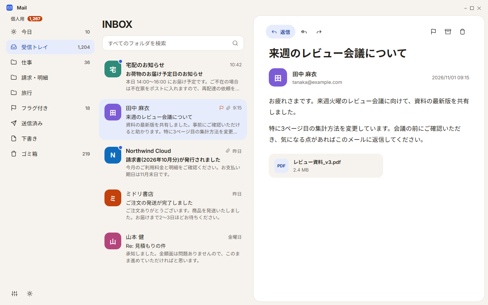
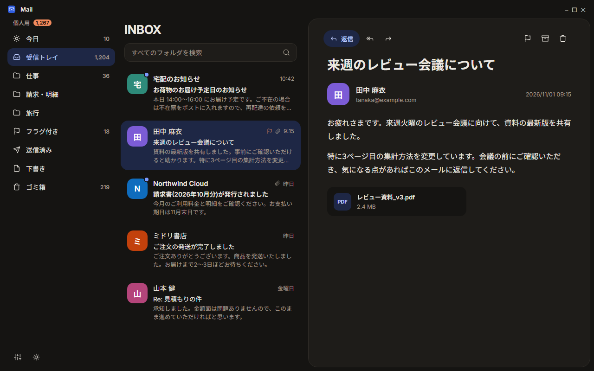

<p align="center">
  
</p>

<h1 align="center">Mail Client</h1>

<p align="center">
  IMAP / SMTP に対応した、Windows 向けのデスクトップメールクライアント（WinUI 3）。<br>
  サイドバー・メール一覧・閲覧ペインの3ペイン構成で、ライト / ダークの両テーマに対応しています。
</p>

<p align="center">
  
  
</p>

> 上の画像は、架空のサンプルデータで描いた**画面イメージ**です（実際のメールが写らないようにしています）。生成方法は [docs/preview](docs/preview) を参照してください。

## 主な機能

- **受信・同期**: IMAP（IDLE によるライブ更新、非対応サーバーはポーリング）。アカウント追加時に受信トレイの全履歴を取得
- **送信**: 返信 / 全員に返信 / 転送。送信キュー（Outbox）経由で、オフライン時も取りこぼしません
- **検索**: SQLite FTS5 による全フォルダ横断の全文検索
- **仕分けルール**: 送信者・件名の条件で、新着メールを自動でフォルダへ移動
- **見た目**: 送信元ロゴ（BIMI / 企業ロゴ、設定でオン・オフ）、メール一覧のプレビュー、ライト / ダーク / システム連動のテーマ切り替え
- **使い勝手**: ワンタイムパスワードを検出して自動でクリップボードにコピー、デスクトップ通知、タスクトレイ常駐、フォルダのドラッグ並べ替え
- **プライバシー**: リモート画像は既定でブロック（トラッキング対策）。パスワードは Windows の資格情報ロッカーに保存

## インストール

[Releases](../../releases) から最新の `MailClient.App_<バージョン>_x64_Test.zip` をダウンロードし、展開して `Add-AppDevPackage.ps1` を実行するか、`.msix` を `Add-AppxPackage` で入れます。

署名は自己署名の証明書（`CN=MasatoToda`）です。初回は同梱の `.cer` を「信頼されたユーザー」に登録する必要があります（スクリプトが案内します）。アップグレードでは、メールや設定のローカルデータは保持されます。

## ビルド

`MailClient.App` は WinUI 3 の MSIX パッケージで、Windows 上でのみビルドできます。

1. **前提**: Visual Studio 2022 以降、ワークロード「.NET デスクトップ開発」「Windows App SDK C# テンプレート」「C++ によるデスクトップ開発」（XAML コンパイラが MSVC ツールセットを要求します）
2. `MailClient.sln` を開き、`MailClient.App` をスタートアッププロジェクトにして `Debug | x64` で実行
3. `Package.appxmanifest` の `Version` を上げてからビルドして、通常の `Add-AppxPackage` でアップグレードインストールします（同一バージョンの再インストールは拒否されます）

テスト（Windows 非依存の部分）:

```
dotnet test tests/MailClient.Data.Tests
dotnet test tests/MailClient.Infrastructure.Tests
dotnet test tests/MailClient.ViewModels.Tests
```

`v*` タグを push すると、GitHub Actions（[.github/workflows](.github/workflows)）が署名済み MSIX をビルドして Release に載せます。

## 構成

```
MailClient.sln
├── src/MailClient.App/            # WinUI 3 ヘッド（packaged, net8.0-windows10.0.19041.0）
├── src/MailClient.ViewModels/     # MVVM ViewModel（net8.0, WinUI 非依存）
├── src/MailClient.Core/           # ドメインモデル + サービスインターフェース（net8.0）
├── src/MailClient.Data/           # SQLite（WAL）+ FTS5 の永続化（net8.0）
├── src/MailClient.Mail/           # MailKit 統合（IMAP / SMTP / 同期エンジン）（net8.0）
├── src/MailClient.Platform/       # 資格情報ロッカー / 通知 / クリップボード（net8.0-windows）
├── src/MailClient.Infrastructure/ # DI 合成ルート・送信元ロゴ取得（net8.0）
├── tests/                         # xUnit テスト
├── tools/GenerateIcons.ps1        # アプリアイコン一式をベクター定義から生成
└── docs/                          # 実装計画、README 用の画面イメージ
```

設計の詳細は [docs/implementation-plan.md](docs/implementation-plan.md) を参照してください。

## ロゴとフォント

- ロゴ（青い角丸タイルに白い封筒）は `tools/GenerateIcons.ps1` で生成します。色や形を変えたら再実行してください
- フォントは [Inter](https://github.com/rsms/inter) と [Noto Sans JP](https://fonts.google.com/noto/specimen/Noto+Sans+JP) をアプリに同梱しています（いずれも SIL Open Font License。ライセンス全文は `src/MailClient.App/Assets/Fonts/OFL-*.txt`）
